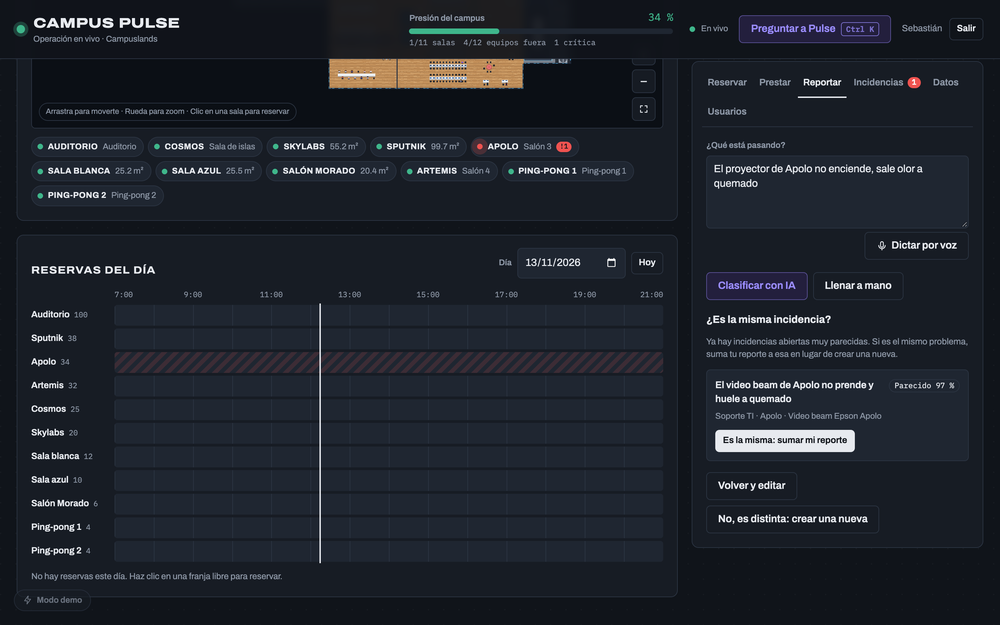
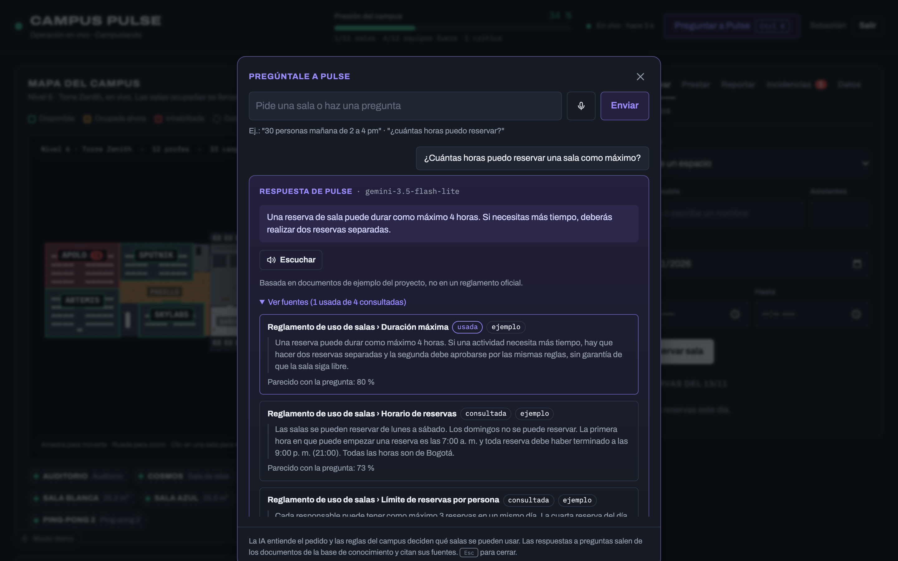
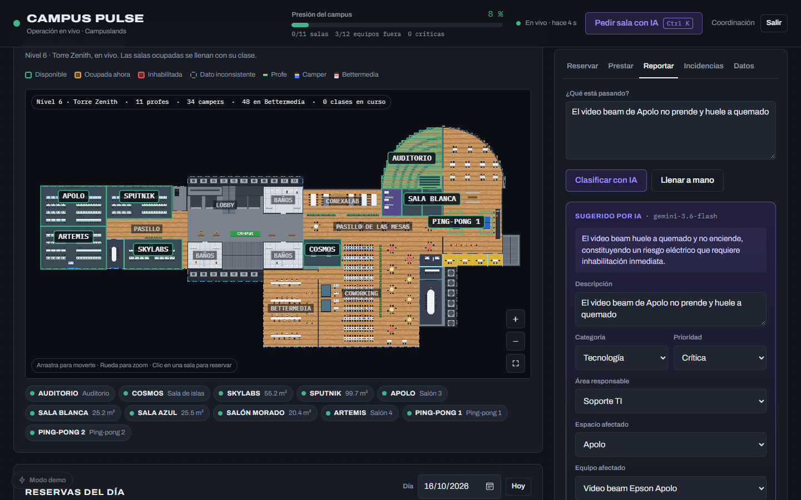
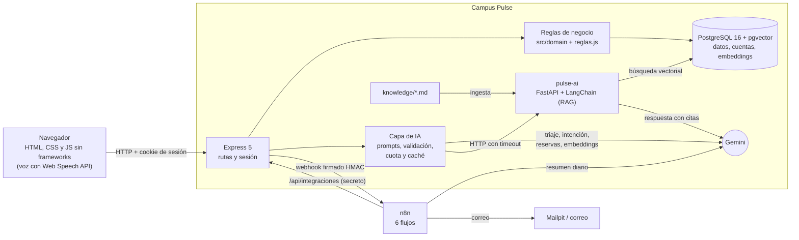

# Campus Pulse

**Un solo tablero para los espacios, los equipos y las incidencias del campus de Campuslands, con una IA que ayuda pero no
decide.** Reservas sin cruces, préstamos con reglas, reportes que llegan al área correcta y un asistente que responde
preguntas citando el reglamento.

> Principio del proyecto: **la IA sugiere, las reglas deciden y la persona confirma.**

| ¿Es la misma incidencia? (embeddings) | Preguntas con fuentes (RAG) | Triaje con IA |
|---|---|---|
|  |  |  |

**v2.0.0** · Node 24 + Express 5 · PostgreSQL 16 + pgvector · Gemini · LangChain (Python) · n8n · Docker ·
[CHANGELOG](CHANGELOG.md) · [Guion de la demo](docs/sustentacion.md)

## Problema

Hoy la información del campus está repartida: qué sala está libre, qué equipo está prestado o dañado y qué incidencias hay
abiertas se consultan en lugares distintos (hojas de cálculo, mensajes, la memoria de alguien). Eso provoca reservas que se
cruzan, salas con sobrecupo, equipos dañados que se vuelven a prestar, reportes repetidos y avisos que no llegan a quien
tiene que arreglar el problema.

## Solución

| Necesidad | Qué hace Campus Pulse |
|---|---|
| Saber qué está libre | **Mapa del campus** en vivo: cada sala con su aforo y estado (libre, ocupada, inhabilitada). |
| Reservar sin cruces | **Reservas** con reglas de horario, aforo, duración y límite por persona; la base de datos impide reservas cruzadas aunque lleguen a la vez. |
| Prestar equipos | **Préstamos** con límite por persona y estados del equipo (disponible, prestado, dañado, en reparación). |
| Reportar sin saber a quién | **Incidencias en lenguaje natural**: la IA sugiere categoría, prioridad, área y lugar; la persona confirma. Lo crítico inhabilita la sala o el equipo al instante. |
| Evitar reportes repetidos | **"¿Es la misma incidencia?"** con embeddings: si ya la reportaron, el reporte se suma en vez de duplicarse. |
| Que el área se entere | **Automatización con n8n**: aviso por correo al área responsable de lo crítico y resumen diario con IA. |
| Pedir sala o resolver dudas rápido | **Barra Ctrl+K** ("Pregúntale a Pulse"): pide una sala en lenguaje natural o pregunta por el reglamento y recibe la respuesta **con sus fuentes**, o un "no lo sé" honesto. También **por voz**. |
| Que todo funcione aunque la IA falle | Cada función de IA tiene su **formulario manual**; si Gemini, `pulse-ai` o n8n caen, el resto sigue funcionando. |

Más capturas: [mapa](docs/capturas/02-mapa.png) · [reserva rechazada por aforo](docs/capturas/03-reserva-rechazada.png) ·
["no lo sé"](docs/capturas/09-no-se.png) · [aviso de n8n](docs/capturas/11-aviso-n8n.png) ·
[en el celular](docs/capturas/12-movil.png) · [sin IA](docs/capturas/07-sin-ia.png).

## Arquitectura



**Cómo leerlo:** la IA nunca escribe directo en la base. Todo lo que cambia datos pasa por las reglas de negocio, y las
respuestas de la IA se validan antes de mostrarse. Si una caja de IA (Gemini, `pulse-ai`, n8n) se cae, el camino
Navegador → Express → Reglas → PostgreSQL sigue funcionando.

<details>
<summary>Estructura del código</summary>

```
public/            Frontend: login, mapa, formularios, incidencias, Ctrl+K, voz
src/server.js      Express: sirve public/ y monta /api/*; exige sesión; manejador global de errores
src/routes/        Rutas HTTP (una por recurso). ia.js -> /api/ia/*, integraciones.js -> lo que llama n8n
src/auth/          Cuentas (scrypt), sesiones y límite de intentos de login
src/domain/        Reglas de negocio: reservas, préstamos, incidencias, similares, fechas, errores
src/config/        reglas.js: TODAS las constantes de negocio y valores cerrados
src/data/          PostgreSQL: almacen.js (foto + diferencias), repos/, migraciones, semilla
src/ai/            Cliente de Gemini, triaje, asistente, intención, cuota, caché, embeddings, cliente de pulse-ai
src/ai/prompts/    Un archivo por prompt del sistema, con la plantilla de la clase
src/integraciones/ Webhook firmado hacia n8n
pulse-ai/          Servicio Python (FastAPI + LangChain): RAG sobre knowledge/ con pgvector
knowledge/         Documentos de ejemplo que Pulse usa para responder preguntas
n8n/               Los 6 flujos de n8n exportados (JSON)
db/migrations/     Esquema SQL
evaluacion/        Conjuntos de prueba de la IA y sus resultados
docs/              Documentación (ver "Documentación" más abajo)
tests/             Pruebas (node:test) · pulse-ai/tests: pruebas de Python (pytest)
```
</details>

El contrato completo de la API está en [docs/contrato-api.md](docs/contrato-api.md). Todos los errores responden
`{error: {codigo, mensaje}}` con el mensaje en español: 422 datos mal formados, 409 regla de negocio violada, 404 ID
inexistente, 401 sin sesión, 403 sin permiso, 429 límite de uso y 503 IA no disponible.

## Historia del proyecto

### v1 — Hackatón de Campuslands (trabajo en equipo)

La primera versión se construyó en equipo durante la Hackatón de Campuslands, en 5 horas, con
el liderazgo de Sebastián Vladimir Acelas (P1). Cada integrante tuvo un rol definido:

| Rol | Integrante | Responsabilidad |
|---|---|---|
| P1 | Sebastián Vladimir Acelas (líder) | Backend: datos, reglas de negocio y API |
| P2 | Jaime Naranjo | IA, integración Git y README |
| P3 | Junior Cuajaro | Frontend y experiencia de usuario |
| P4 | Thomas Serrano | Datos oficiales y pruebas de datos y fechas |
| P5 | Sebastian Diaz | Documentación de la demo y del reto en vivo |

El resultado de la hackatón es la versión `v1.1.1` (ver [CHANGELOG.md](CHANGELOG.md)).

> El historial de Git de la hackatón quedó en el repositorio del equipo. Este repositorio parte
> de la `v1.1.1` tal como quedó al terminar (commit `chore(repo): importar el estado actual de la
> v1.1.1`), y desde ahí registra todo el trabajo de la v2.

### v2 — Desarrollo individual

A partir de la `v1.1.1`, Sebastián Vladimir Acelas continúa el proyecto de forma individual como proyecto final del curso
Inteligencia Artificial 2 (Campuslands), del 31 de octubre al 27 de noviembre de 2026, con Gitflow y un pull request por
tarea. Lo que agregó la v2:

| Fase | Qué se hizo |
|---|---|
| 0–1 | Documentación, roles (admin, profesor, soporte técnico), límite de intentos de login, cookie segura, límite y caché de la IA |
| 2 | PostgreSQL con pgvector en Docker, migraciones y reservas simultáneas a prueba de cruces |
| 3A | Prompts con la plantilla de la clase, personalidad Big Five de Pulse y few-shot medido (no mejoró: se desactivó) |
| 3B | Incidencias parecidas con embeddings ("¿Es la misma incidencia?") |
| 3C | RAG con LangChain: preguntas con fuentes y "no lo sé" |
| 3D | Voz: dictado y lectura en voz alta |
| 3E | Decisiones documentadas (RAG frente a fine-tuning, pgvector frente a Qdrant y Chroma) |
| 3F | n8n: webhook firmado, avisos por área, resumen diario con IA, ingesta y agente |
| 4 | Rendimiento y cuota de la IA, revisión de seguridad, README, evidencias y `v2.0.0` |

El detalle de cada cambio está en [CHANGELOG.md](CHANGELOG.md).

## Stack

- **Node.js 24** + **Express 5**, módulos ES. **Frontend** en HTML, CSS y JavaScript nativo, sin frameworks ni build.
- **PostgreSQL 16 con pgvector** (Docker): datos del campus, cuentas, sesiones, embeddings y base de conocimiento.
  Ver [docs/base-de-datos.md](docs/base-de-datos.md).
- **IA:** Google Gemini con `@google/genai` (Node) y **LangChain** en Python (`pulse-ai`, FastAPI) para el RAG.
- **Automatización:** **n8n** (Community, autoalojado) y **Mailpit** como buzón de correo local.
- **Pruebas:** `node:test` (Node) y `pytest` (Python).

## Inicio de sesión

- Toda la API (salvo `/api/auth/*`) exige una sesión. Sin sesión, la interfaz lleva a
  `login.html` y, al entrar, vuelve a la página que se estaba usando (también `movil.html`).
- **No hay usuarios ni contraseñas en el repositorio.** La primera vez se crea una cuenta desde
  "Crear una cuenta" (usuario de 3 a 30 caracteres y contraseña de al menos 8): esa cuenta es
  `admin`. Después el registro se cierra (el login oculta "Crear una cuenta") y el admin crea las
  demás desde la pestaña **Usuarios** (`POST /api/usuarios`).
- La interfaz oculta lo que el rol no puede hacer (el botón "Restaurar", "Marcar como resuelta" y
  la pestaña Usuarios); aun así, quien impide las acciones es el servidor, con 403.
- **Tres roles:** `admin` (crea cuentas y restaura datos), `profesor` (reserva, presta y reporta)
  y `soporte_tecnico` (además resuelve incidencias, lo que rehabilita espacios y equipos). La
  tabla de permisos está en [docs/contrato-api.md](docs/contrato-api.md).
- Las contraseñas se guardan con hash `scrypt` y sal aleatoria, y las sesiones con el hash de su
  token, en PostgreSQL (tablas `usuarios` y `sesiones`). La sesión dura 8 horas y viaja en una cookie
  `HttpOnly`, que además es `Secure` (solo HTTPS) cuando `NODE_ENV=production`.
- Tras **5 intentos fallidos** del mismo usuario desde la misma IP en 15 minutos, el login
  responde `429` hasta que pase la ventana (`src/auth/intentos.js`). Los contadores viven en
  memoria y se borran al reiniciar el servidor.
- **Restaurar datos** no borra las cuentas, y las sesiones sobreviven a los reinicios de
  `npm run dev` (útil en el reto en vivo).
- Si venías de la versión con `data/auth.json`, copia tus cuentas con `npm run importar-cuentas`
  (los hashes se copian tal cual; las sesiones no, así que vuelve a iniciar sesión).

## Rol de la IA y cómo se controla

La IA aparece en seis lugares y en todos **solo sugiere**: nunca escribe en la base de datos ni decide si algo está
permitido. Resumen:

| Función | Qué hace la IA | Qué deciden las reglas o la persona | Si la IA falla |
|---|---|---|---|
| Triaje de incidencias | Sugiere categoría, prioridad, área y lugar | La persona confirma; la salida se valida contra el catálogo | Formulario manual |
| Asistente de reservas | Entiende el pedido y explica las opciones | Las reglas eligen las salas; reservar vuelve a validar todo | Formulario de reserva |
| Incidencias parecidas | Convierte el texto en un vector | Umbral + filtro de lugar; la persona decide si es la misma | Se crea la incidencia igual |
| Preguntas (RAG) | Responde con los fragmentos recuperados | Sin una cita válida, la respuesta es "no lo sé" | Mensaje claro; el resto sigue |
| Voz | Dicta y lee en voz alta (navegador) | La persona revisa el texto antes de enviarlo | Sin botones; todo por texto |
| n8n | Resume el día | Un Code node valida el JSON contra los datos reales | El Error Workflow avisa al admin |

### 1. Triaje de incidencias — `POST /api/ia/triaje`

1. La persona describe el problema: _"El video beam de Apolo no prende y huele a quemado"_.
2. El prompt incluye el **catálogo real** (IDs y nombres de espacios y recursos), los valores
   cerrados y la regla de cuándo inhabilitar.
3. Gemini responde un JSON forzado por **schema**: los enums y los IDs van como listas cerradas.
4. `src/ai/validar.js` vuelve a comprobar todo: un valor fuera de los enums o un ID que no existe
   se convierte en `null` y la interfaz pide elegirlo a mano.
5. La interfaz muestra la sugerencia como **"Sugerido por IA"**, con la razón, y la persona la
   puede editar. Solo al confirmar se llama a `POST /api/incidencias`, donde las reglas deciden.

### 2. Asistente de reservas — `POST /api/ia/recomendar`

1. La IA **extrae** `{asistentes, inicio, fin}` del texto, con la fecha actual y la zona
   `America/Bogota`.
2. Las **reglas** filtran: `buscarEspaciosDisponibles` devuelve solo los espacios que cumplen
   aforo, horario, días hábiles, duración, estado y no solapamiento, ordenados por mejor ajuste.
3. La IA solo **redacta** la explicación de esas opciones ya filtradas. Si menciona un espacio
   que no estaba en la lista, se descarta.

### 3. Incidencias parecidas — `POST /api/ia/similares`

1. La IA convierte el texto en un **embedding** (768 números) con `gemini-embedding-001`.
2. **pgvector** busca las incidencias abiertas con el vector más cercano (distancia coseno, índice HNSW).
3. Las **reglas** deciden cuáles se sugieren: solo las del mismo equipo o espacio que identificó el
   triaje, y que lleguen al umbral de similitud (`UMBRAL_SIMILITUD_INCIDENCIA`).
4. La interfaz pregunta *"¿Es la misma incidencia?"*. Si la persona confirma, su reporte se suma a la
   existente (`POST /api/incidencias/:id/reportes`) en vez de crear un duplicado.

Si el servicio de embeddings falla, la incidencia se crea igual, sin la sugerencia. Detalle,
mediciones y decisiones en [docs/incidencias-parecidas.md](docs/incidencias-parecidas.md).

### 4. Preguntas con fuentes (RAG) — `POST /api/ia/preguntar` y la barra Ctrl+K

La barra **Ctrl+K** entiende dos cosas: pedir una sala (flujo 2) o hacer una pregunta. La IA decide cuál
(`POST /api/ia/asistente`). Las preguntas ("¿cuántas horas puedo reservar una sala?") las responde el
servicio `pulse-ai` con **RAG**:

1. Busca en pgvector los fragmentos de `knowledge/` más cercanos a la pregunta.
2. Un **reranking** con Gemini deja los 4 más útiles.
3. Gemini responde **solo con esos fragmentos y dice cuáles usó**; la interfaz los muestra en *Ver fuentes*.
4. Si los documentos no tienen la respuesta, Pulse **dice que no la sabe** (y sugiere un área) en vez de inventar.
   Una respuesta sin una cita válida también cuenta como "no sé".
5. Recuerda los últimos 6 mensajes para entender seguimientos ("¿y los domingos?").

Con la capa gratis hay un **presupuesto global de llamadas**, **modo ahorro** y respuestas en caché para que alcance para varias
personas a la vez: ver [docs/capacidad-ia.md](docs/capacidad-ia.md).

Si `pulse-ai` o Gemini fallan, solo falla esta función: reservas, préstamos e incidencias siguen igual.
Los documentos son **de ejemplo**, no un reglamento oficial. Diseño, decisiones y problemas encontrados en
[docs/rag.md](docs/rag.md); medición de las 15 preguntas de prueba en [docs/evaluacion-rag.md](docs/evaluacion-rag.md).
Por qué RAG y no fine-tuning, y por qué pgvector y no Qdrant o Chroma: [docs/decisiones.md](docs/decisiones.md).

### 5. Voz (Web Speech API del navegador)

- **Dictado (STT):** un botón de micrófono en el reporte de incidencias y en la barra Ctrl+K convierte lo que dices en
  texto dentro del campo. Solo escribe: revisas y envías como siempre, y el texto pasa por el triaje normal.
- **Respuesta hablada (TTS):** las respuestas de Pulse y las recomendaciones de salas tienen un botón **Escuchar**
  (`speechSynthesis`, con voz en español si el sistema tiene una).
- **Sin soporte, sin problema:** si el navegador no tiene la API (Firefox no tiene reconocimiento de voz), los botones no
  aparecen y todo sigue funcionando por texto.
- **Privacidad:** en Chrome el reconocimiento lo hace el servicio de voz del navegador, que envía el audio a un servidor
  del proveedor. No pasa por Campus Pulse ni se guarda aquí. Solo funciona con `localhost` o HTTPS.

### 6. Automatización con n8n y webhooks

Al crear una incidencia, Express envía un **webhook firmado** (HMAC-SHA256, con protección contra repetición) a **n8n**, que
valida la firma, enruta por área (**Switch**), avisa por correo con un **subworkflow**, une los resultados (**Merge**) y llama
de vuelta a Campus Pulse para dejar constancia (*"Avisada: Soporte TI"* en la lista). Las críticas avisan al instante; el resto
va a un **resumen diario con IA** (Gemini devuelve JSON y un Code node lo valida contra los datos reales antes de enviarlo).
Hay además un flujo de **ingesta de documentos** por formulario (Document Loader, Embeddings, PGVector), un **agente de
coordinación** con memoria y un **Error Workflow**. Todo en Docker, gratis, con los correos en un buzón local (Mailpit).
Detalle, pruebas y límites en [docs/workflows.md](docs/workflows.md); los flujos exportados están en [n8n/](n8n/).

### Controles

- Salida JSON por schema, temperatura 0.2, timeout de 15 s y un reintento (`src/ai/cliente.js`).
- El texto del usuario va delimitado y se le indica a la IA que es un dato, no instrucciones.
- **Sin respuestas simuladas**: si la IA falla o no hay key, la API responde
  `503 {error: {codigo: "IA_NO_DISPONIBLE", mensaje}}` y la interfaz ofrece el formulario manual.
- **Límite por usuario:** 5 consultas a la IA por minuto (`src/ai/limite.js`). Al pasarse responde
  `429 LIMITE_IA` en español y la interfaz ofrece el formulario manual.
- **Caché del triaje:** un texto idéntico se responde desde la memoria durante 10 minutos
  (`src/ai/cache.js`) y no gasta cuota de Gemini. La recomendación de salas no se cachea porque
  depende de la disponibilidad y de la fecha.
- **Personalidad:** Pulse tiene una personalidad definida con el modelo Big Five (responsabilidad
  alta, amabilidad alta, extraversión media, apertura media, neuroticismo bajo), justificada en
  [docs/personalidad.md](docs/personalidad.md). Solo ajusta el tono; no cambia reglas ni límites.
- **Few-shot medido:** el triaje se midió con y sin 4 ejemplos sobre 12 reportes. El few-shot no mejoró (empate 10 a 10 tras
  corregir una política ambigua) y costaba 420 tokens más por llamada, así que va sin ejemplos; el detalle está en
  [docs/biblioteca-prompts.md](docs/biblioteca-prompts.md).
- Cambiar de proveedor de IA solo exige tocar `src/ai/cliente.js`.

## Uso de IA en el desarrollo

Campus Pulse usa IA en dos lugares distintos, y conviene no confundirlos:

1. **IA dentro del producto** (Gemini): sugiere en el triaje de incidencias y en el asistente de
   reservas. Está descrita arriba, en "Rol de la IA y cómo se controla".
2. **IA como herramienta de desarrollo** (esta sección): desde el 2 de noviembre de 2026, la v2 se
   desarrolla con ayuda de un asistente de programación (Claude Code, de Anthropic).

### Quién hace qué

- **Sebastián Vladimir Acelas decide y responde por el proyecto.** Define el alcance en el plan de
  la v2, revisa cada cambio antes de integrarlo y es el único que hace `push` y abre los pull
  requests. Todo el código publicado es responsabilidad suya y debe poder explicarlo.
- **El asistente propone y escribe borradores** de código, pruebas y documentación en ramas
  locales, y explica cada decisión de diseño.
- **Lo que escribió cada uno, sin maquillarlo:** en las Fases 0 a 2 el asistente escribió borradores que el
  autor integró por pull request. En la **Fase 3** (RAG con `pulse-ai`, sus prompts, la voz y los flujos de n8n), para
  cumplir el plazo, el autor pidió al asistente que escribiera el código completo; el autor lo integró por
  pull request y lo estudia con [docs/sustentacion.md](docs/sustentacion.md) para poder explicarlo y
  modificarlo. Las decisiones de producto (alcance, roles, qué ve cada persona) son del autor.

### Controles

- Una rama por tarea y un pull request a `develop`: ningún cambio llega sin revisión humana.
- `npm test` debe pasar antes de cada commit; cada función nueva trae sus pruebas.
- Los commits son del autor. Sin firmas ni coautores automáticos: la trazabilidad está aquí y en
  el historial de pull requests.
- Nunca se suben claves: `.env`, `data/db.json` y `data/auth.json` están en `.gitignore`, y el
  asistente no lee ni imprime claves.
- Cuando una decisión de diseño es dudosa, el asistente no la toma: la deja anotada como pregunta
  para que el autor decida.
- La documentación no afirma nada que no se haya comprobado (por ejemplo, el CHANGELOG solo
  describe lo que consta en el repositorio).

## Reglas de negocio

Todas viven en [`src/config/reglas.js`](src/config/reglas.js). Para cambiar una regla basta con
editar un valor y guardar (`npm run dev` reinicia el servidor solo).

| Regla | Constante | Valor actual |
|---|---|---|
| Los asistentes no superan el aforo (× margen) | `MARGEN_AFORO` | `1.0` |
| Horario del campus | `HORA_APERTURA` / `HORA_CIERRE` | 7:00 a 21:00 |
| Anticipación mínima para reservar (0 = no se reserva en el pasado) | `ANTICIPACION_MINIMA_MINUTOS` | `0` |
| Duración máxima de una reserva | `MAX_HORAS_RESERVA` | 4 horas |
| Días en que se puede reservar (0 = domingo) | `DIAS_HABILES` | lunes a sábado |
| Reservas por persona y día | `MAX_RESERVAS_POR_PERSONA_DIA` | 3 |
| Préstamos activos por persona | `MAX_PRESTAMOS_POR_PERSONA` | 2 |
| Estados de espacio que no se pueden reservar | `ESTADOS_NO_ASIGNABLES` | inhabilitado, inconsistente |
| Prioridades que inhabilitan automáticamente | `PRIORIDADES_QUE_INHABILITAN` | critica |
| Estado al que pasa un equipo cuando una incidencia lo inhabilita | `ESTADO_RECURSO_INHABILITADO` | en_reparacion |
| Cambios de estado de un equipo | `TRANSICIONES_RECURSO` | disponible → prestado / en reparación; prestado → disponible / dañado; dañado → en reparación; en reparación → disponible |
| Salas con computadores (si el pedido los necesita, solo se recomiendan estas) | `ESPACIOS_CON_COMPUTADORES` | apolo, spooki, artemis, skilab |
| Tipos de espacio que la IA nunca recomienda | `TIPOS_FUERA_DE_RECOMENDACION` | mesa_juego |
| Consultas a la IA por usuario en la ventana | `LIMITE_IA_PETICIONES` / `LIMITE_IA_VENTANA_MINUTOS` | 5 por minuto |
| Minutos que se guarda la respuesta del triaje | `CACHE_IA_MINUTOS` | 10 |
| Similitud mínima para sugerir una incidencia parecida (provisional) | `UMBRAL_SIMILITUD_INCIDENCIA` | 0.93 |
| Cuántas incidencias parecidas se muestran | `MAX_INCIDENCIAS_PARECIDAS` | 3 |

Además:

- Dos reservas del mismo espacio no se pueden cruzar (las franjas pegadas, como 10–12 y 12–14,
  sí se permiten).
- **Editar** una reserva (`PATCH /api/reservas/:id`) vuelve a pasar por todas las reglas de arriba;
  la reserva no choca consigo misma. **Cancelar** (`DELETE /api/reservas/:id`) la elimina.
- Una reserva que **ya empezó** no se puede editar ni cancelar.
- Una incidencia con `inhabilitar: true` o con una prioridad de `PRIORIDADES_QUE_INHABILITAN`
  inhabilita el espacio o equipo afectado. Al resolverla se rehabilita, salvo que otra incidencia
  abierta lo siga inhabilitando.

## Instalación y ejecución

Requisitos: **Node.js 24** o superior y **Docker** (para PostgreSQL).

```bash
git clone https://github.com/sebastianace/CampusPulse_VladimirAcelas.git
cd CampusPulse_VladimirAcelas
npm install
cp .env.example .env
```

Edita `.env` (nunca lo subas al repositorio):

```
GEMINI_API_KEY=tu_key_de_google_ai_studio
GEMINI_MODEL=gemini-3.6-flash
PORT=3000
POSTGRES_PASSWORD=una_contraseña_que_tu_elijas
POSTGRES_PUERTO=5433
```

Hay dos formas de correrlo:

**A. Todo en Docker** (la más simple; no hace falta tener Node instalado):

```bash
docker compose up -d --build
```

Levanta cinco servicios: la base (`db`), la app (`app`, en `http://localhost:3000`), el RAG (`pulse-ai`,
en `http://localhost:8000`), n8n (`http://localhost:5678`) y un buzón de correo de prueba (`mailpit`,
`http://localhost:8025`). La primera vez aplica las migraciones, carga los datos iniciales y los
documentos de `knowledge/` solas. Para las automatizaciones define `N8N_SECRETO` en `.env` y corre
`npm run n8n:preparar` (ver [docs/workflows.md](docs/workflows.md)). Para apagarla: `docker compose stop` (conserva los datos) o `docker compose down -v`
(borra también los datos).

**B. Solo la base en Docker y la app con Node** (para desarrollar; se reinicia al guardar):

```bash
docker compose up -d db pulse-ai
npm run dev
```

No corras las dos a la vez: usan el mismo puerto (3000). Con `NODE_ENV=production` la cookie de
sesión es `Secure` y solo viaja por HTTPS: déjalo vacío mientras uses `http://localhost`.

`GEMINI_MODEL` es el id exacto del modelo (por ejemplo `gemini-3.6-flash`, el que usamos en la
demo). Si `npm run probar-ia` responde 503 ("high demand"), el modelo está saturado en ese
momento: prueba otro modelo flash de tu cuenta. La capa gratis de Gemini permite **5 peticiones
por minuto por modelo** (en el modelo que usamos al medir el RAG, 15) **para todo el campus junto**. El triaje usa 1
llamada, pedir una sala 2 (1 en modo ahorro) y una pregunta nueva 1; las repetidas salen de la caché. Si se supera,
la app responde con el
error claro y el formulario manual, nunca con una respuesta inventada.

| Comando | Qué hace |
|---|---|
| `npm start` | Arranca el servidor en `http://localhost:3000` |
| `npm run dev` | Igual, pero se reinicia solo al guardar un archivo |
| `npm test` | Ejecuta las pruebas de las reglas |
| `npm run probar-ia` | Comprueba que la key y el modelo de Gemini responden |
| `npm run migrar` | Aplica las migraciones de `db/migrations/` a PostgreSQL (necesita `docker compose up -d db`) |
| `npm run embeddings` | Genera el embedding de las incidencias que no lo tienen (usa la clave de Gemini) |
| `npm run importar-cuentas` | Copia las cuentas del viejo `data/auth.json` a PostgreSQL (se corre una vez) |
| `npm run n8n:preparar` | Crea las credenciales en n8n, importa y activa los flujos de `n8n/` y reinicia n8n |
| `npm run conocimiento` | Recarga `knowledge/` en la base vectorial (necesita `pulse-ai` levantado) |
| `npm run evaluar-rag` | Hace las 15 preguntas de prueba del RAG, con y sin reranking (gasta cuota de Gemini, ~8 min) |
| `npm run semilla` | Carga espacios, recursos y calidad de datos en PostgreSQL |
| `npm run medir-triaje` | Mide el triaje sin ejemplos y con ellos (24 llamadas a Gemini, ~5 min; gasta cuota) |

Abre `http://localhost:3000` y crea una cuenta con **Crear una cuenta** (solo la primera vez).

Sin la clave de Gemini la aplicación funciona igual: las funciones de IA muestran un error claro y
se usa el formulario manual. **Sin PostgreSQL no arranca**: si ves "No hay conexión con PostgreSQL",
abre Docker Desktop y corre `docker compose up -d db`.

La primera vez que arranca, la app carga en PostgreSQL los datos de `data/raw/espacios.csv`,
`data/seed/espacios-extra.json` y `data/seed/recursos.json`. El botón **Restaurar**
(`POST /api/restaurar`) vuelve a ese estado inicial.

## Suposiciones sobre los datos

- `data/raw/espacios.csv` contiene la **capacidad instalada compartida por la organización**
  (9 espacios: Auditorio 100, Cosmos 25, Skilab 20, Spooki 38, Apolo 34, Blanca 12, Azul 10,
  Amarillas verdes 6, Artemis 32) y **nunca se modifica**. Un test verifica que se carga completo.
- Los nombres se normalizan (espacios sobrantes, mayúsculas) y el ID se genera del nombre:
  `Amarillas verdes` → `amarillas-verdes`.
- Un registro con aforo vacío, no numérico, decimal o menor o igual a 0 se carga como
  **inconsistente**: se ve en gris y no se puede reservar.
- Las filas sin nombre y los nombres duplicados solo aparecen en el reporte de calidad (se
  conserva la primera fila válida).
- Un registro inválido nunca detiene la carga.
- Los recursos tecnológicos son **ficticios** (`"ficticio": true` en `data/seed/recursos.json`),
  porque no se entregó un inventario oficial.
- **Salas con computadores:** Apolo, Spooki, Artemis y Skilab tienen computadores; Cosmos, Blanca,
  Azul, Amarillas verdes y el Auditorio no. El CSV oficial no trae este dato: lo aportó el equipo
  a partir de su conocimiento de las salas del campus. Vive en `ESPACIOS_CON_COMPUTADORES` de
  `src/config/reglas.js` y se puede cambiar en vivo.
- **Mesas de ping-pong:** `Ping-pong 1` y `Ping-pong 2` (aforo 4) no están en el CSV oficial; se
  agregan desde `data/seed/espacios-extra.json`, que no altera `data/raw/` ni el reporte de calidad.
- Todas las fechas usan el formato `YYYY-MM-DDTHH:mm` en hora local de Bogotá, sin zona horaria.

## Demo y reto en vivo

- [Sustentación](docs/sustentacion.md): guion de la demo de 6 minutos de la v2, plan B si algo falla, preguntas difíciles y
  plan de estudio de cada pieza.
- [Guion de la demo de la v1](docs/demo.md): los pasos de la demostración de la hackatón con capturas.
- [Guía del reto en vivo](docs/reto-en-vivo.md): qué valor de `src/config/reglas.js` cambiar para
  cada pedido del jurado y cómo comprobarlo.

## Flujo de trabajo (Gitflow)

- `main`: versión estable. Cada versión publicada lleva su etiqueta (`v1.1.1`, `v2.0.0`…).
- `develop`: integración. Todo entra aquí por pull request.
- `feature/<tema>`: una rama por tarea (por ejemplo `feature/fase-1-seguridad`). Sale de
  `develop` y vuelve a `develop` por pull request con merge commit (sin squash), aunque el
  trabajo sea individual: el PR queda como evidencia de la revisión.
- `release/<versión>`: congelamiento antes de publicar (solo correcciones y documentación);
  se integra a `main` con su etiqueta y de vuelta a `develop`.

Reglas de cada commit:

- Formato `tipo(ámbito): descripción en español`, por ejemplo `feat(auth): agregar roles`.
  Tipos: `feat`, `fix`, `docs`, `test`, `refactor`, `chore`.
- `npm test` pasa antes de cada commit.
- `.env`, `data/db.json` y `data/auth.json` nunca se suben (están en `.gitignore`).

En la hackatón (v1) cada integrante trabajó en su rama (`feature/backend`, `feature/ia`,
`feature/frontend`) y se integró a `develop` por pull request.

## Pruebas y calidad

| Qué | Cómo se comprueba |
|---|---|
| Reglas, API, roles, base de datos, IA, n8n y voz | `npm test`: más de 300 pruebas con `node:test`, contra una base PostgreSQL temporal por archivo (necesita `docker compose up -d db`). Ninguna llama a Gemini: usan IA simulada. |
| Servicio de RAG | `docker compose run --rm --no-deps -e POSTGRES_HOST=db -e POSTGRES_PUERTO=5432 pulse-ai python -m pytest` (más de 50 pruebas). |
| Calidad de la IA con Gemini real | `npm run medir-triaje` (few-shot frente a zero-shot), `npm run evaluar-rag` (15 preguntas), `npm run comparar-modelos` (matriz de modelos). |
| Que las pruebas detecten errores | Pruebas de mutación manuales durante el desarrollo: se rompió a propósito cada regla clave (cupo, firma, caché, presupuesto, reglas de intención…) y se comprobó que algún test fallara. |
| Dependencias | `npm audit` y `pip-audit` sin vulnerabilidades conocidas en la revisión de la v2.0.0. |
| Interfaz | Recorridos en Chrome real (escritorio y celular) durante el desarrollo. |

## Documentación

| Documento | De qué trata |
|---|---|
| [docs/decisiones.md](docs/decisiones.md) | Por qué RAG y no fine-tuning, pgvector y no Qdrant ni Chroma, la IA no escribe en la base, el no-solapamiento en la base, n8n frente a código |
| [docs/rag.md](docs/rag.md) · [docs/evaluacion-rag.md](docs/evaluacion-rag.md) | Cómo funciona el RAG y su evaluación con 15 preguntas |
| [docs/capacidad-ia.md](docs/capacidad-ia.md) | Cuántas personas atiende la IA gratis y cómo se cuida la cuota |
| [docs/matriz-modelos.md](docs/matriz-modelos.md) | Comparación de modelos de Gemini: aciertos, tiempo, tokens y costo |
| [docs/incidencias-parecidas.md](docs/incidencias-parecidas.md) | Embeddings, similitud coseno y el umbral |
| [docs/biblioteca-prompts.md](docs/biblioteca-prompts.md) · [docs/personalidad.md](docs/personalidad.md) | Los prompts, sus versiones y la personalidad Big Five de Pulse |
| [docs/workflows.md](docs/workflows.md) | Los 6 flujos de n8n, lo verificado y sus límites |
| [docs/base-de-datos.md](docs/base-de-datos.md) · [docs/contrato-api.md](docs/contrato-api.md) | Esquema y API |
| [docs/registro-depuracion.md](docs/registro-depuracion.md) | Fallos reales, cómo se encontró la causa y qué los evita |
| [docs/sustentacion.md](docs/sustentacion.md) | Guion de la demo, plan B y plan de estudio |
| [docs/hoja-de-ruta.md](docs/hoja-de-ruta.md) | Trabajo futuro: qué haría falta para usarlo en todo el campus |

## Trabajo futuro

Lo más importante para pasar de proyecto a herramienta del campus: un piloto medido en una torre, inicio de sesión con las
cuentas de Campuslands, códigos QR en cada sala para reportar, liberar automáticamente las salas reservadas que nadie usa y un
plan de pago de Gemini. Detalle, costos estimados y riesgos en [docs/hoja-de-ruta.md](docs/hoja-de-ruta.md).

## Autor

**Sebastián Vladimir Acelas** · Campuslands, curso Inteligencia Artificial 2 (2026). La v1 se hizo en equipo en la hackatón
(ver "Historia del proyecto").

