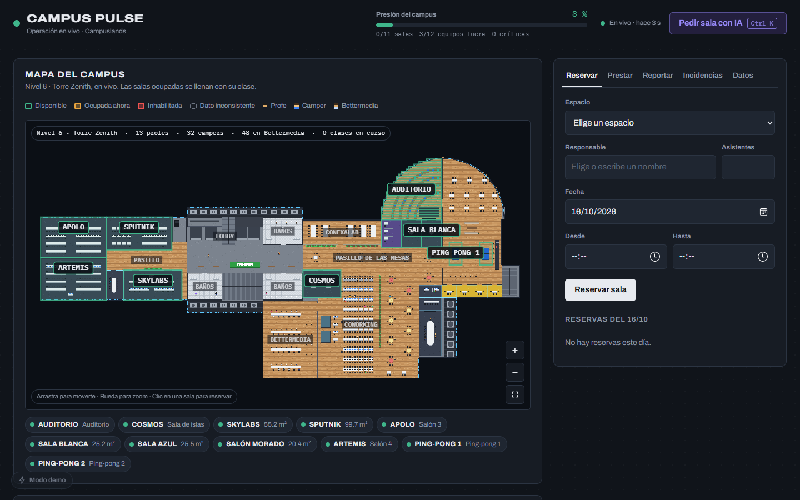
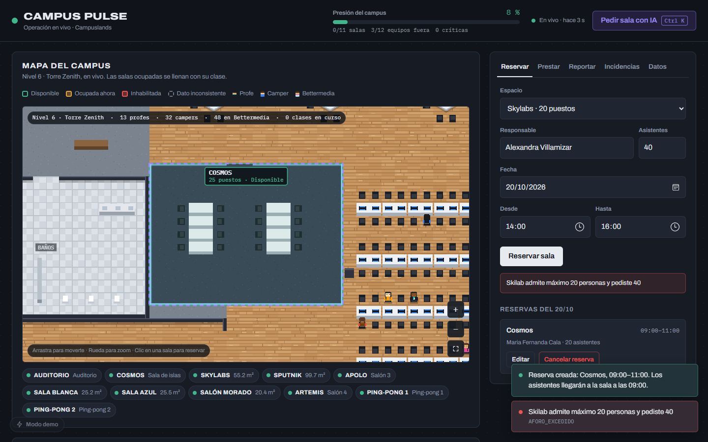
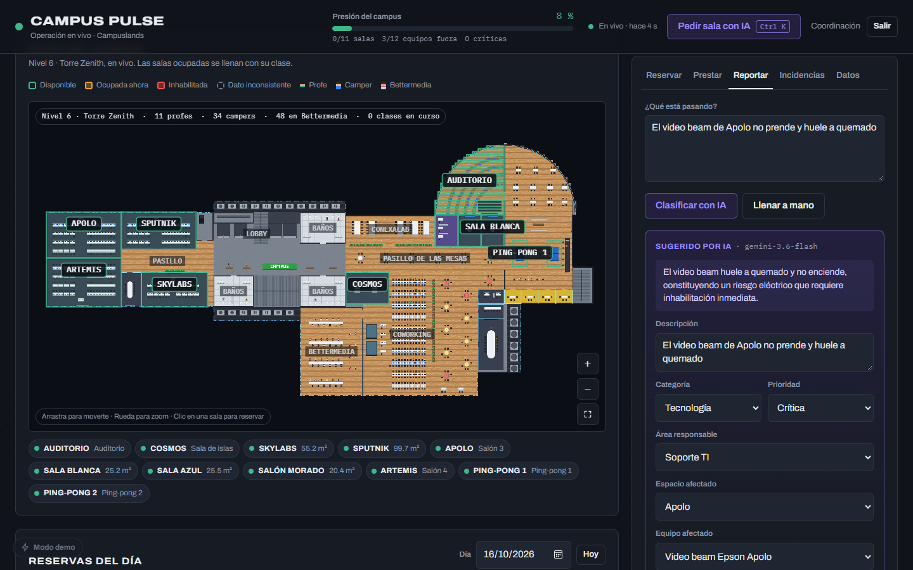
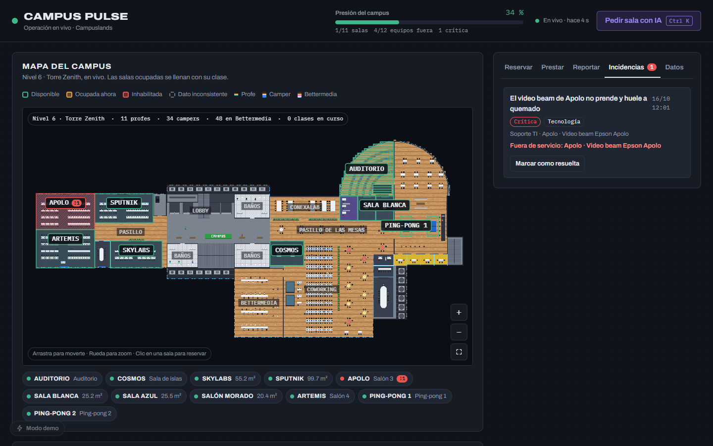
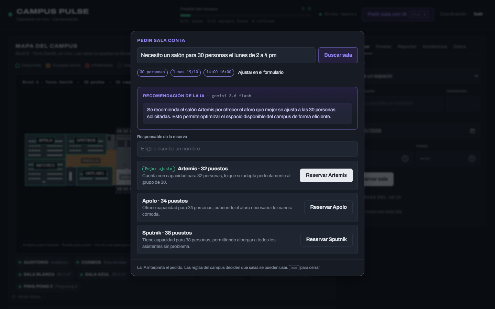
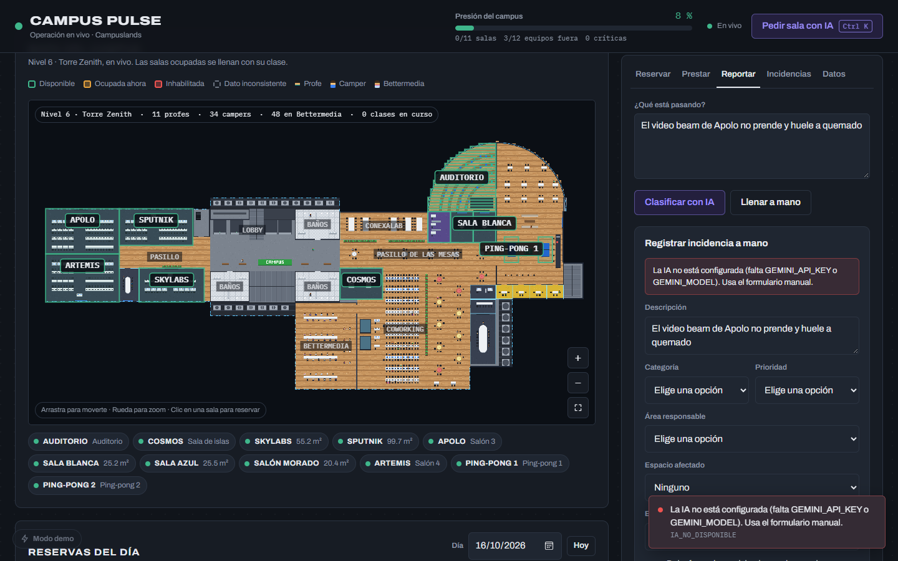

# Guion de la demo

Demostración de Campus Pulse en 3 minutos. Cada paso muestra una regla de negocio o el papel de
la IA. Antes de empezar: `npm run restaurar` en la terminal (deja los datos iniciales sin borrar
las cuentas) e iniciar sesión (o **Crear una cuenta** la primera vez).

## 1. Datos oficiales y su calidad

Los 9 espacios oficiales se cargan desde `data/raw/espacios.csv`. Cualquier registro inválido
(duplicado, vacío, aforo no numérico o ≤ 0) se valida al cargar, sin romper la aplicación: la sala
queda en gris en el plano y en **Inventario** aparece como "Dato inconsistente en el CSV oficial".
El reporte completo, con fila y motivo, está en `GET /api/calidad-datos`. (La pestaña "Datos" se
quitó: al campus le sirve ver qué sala no se puede usar, no un reporte técnico del archivo.)

## 2. Mapa de ocupación

Cada sala se dibuja proporcional a su aforo, con color por estado: verde disponible, ámbar
ocupada, rojo inhabilitada y gris dato inconsistente.

## 3. Reglas de reservas

| Acción | Resultado esperado |
|---|---|
| Reservar **Cosmos** para 20 personas | Se acepta |
| Reservar **Cosmos** en la misma franja | Se rechaza por solapamiento |
| Reservar **Skilab** para 40 personas | Se rechaza por aforo (máximo 20) |

## 4. Incidencia con IA

Reportar: _"Hay una gotera en el techo de Apolo y el agua cae cerca de los enchufes"_.

1. La IA sugiere categoría, prioridad y espacio, con su razón (**"Sugerido por IA"**). El área no se elige: toda incidencia la atiende Soporte TI.
2. La persona revisa, puede editar y elige **qué queda fuera de servicio**: nada, solo el equipo o toda la sala.
   Como el riesgo es de la sala, viene marcado "Toda la sala".
3. Al confirmar, **Apolo se pone rojo**.

Se inhabilita **lo más específico**: si el reporte fuera _"El video beam de Apolo no prende"_, solo el video beam
quedaría en reparación y Apolo se seguiría reservando.

## 5. Las reglas deciden

| Acción | Resultado esperado |
|---|---|
| Reservar **Apolo** | Se rechaza: está inhabilitado |
| Prestar un equipo **dañado** | Se rechaza: no puede pasar de dañado a prestado |

## 6. Asistente de reservas (Ctrl+K)

_"Necesito un salón para 30 personas mañana de 2 a 4 pm"_. La IA entiende la solicitud, las
reglas filtran las salas libres que cumplen todo y la IA solo explica las opciones.

## 7. Sin IA, el sistema sigue funcionando

Sin key de IA, el reporte muestra un error claro y abre el formulario manual. Nunca se inventa
una respuesta.

