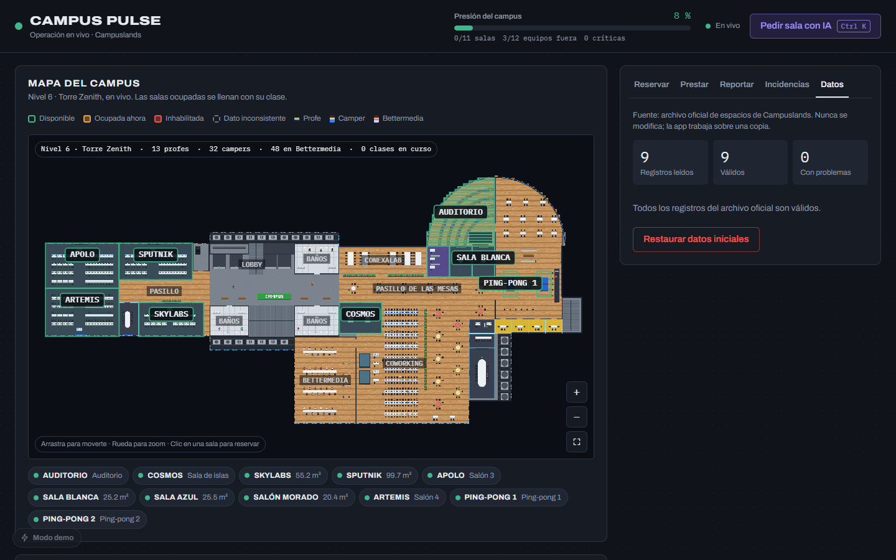
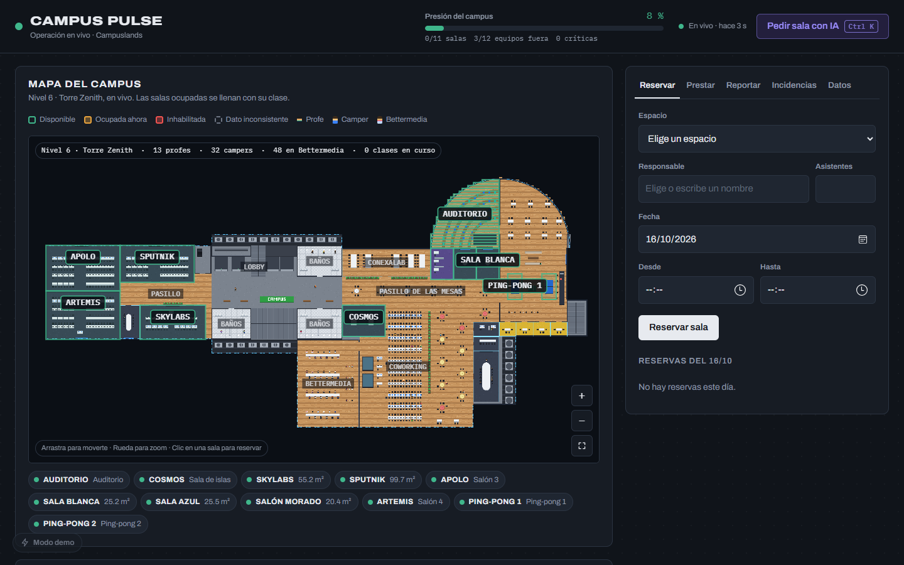
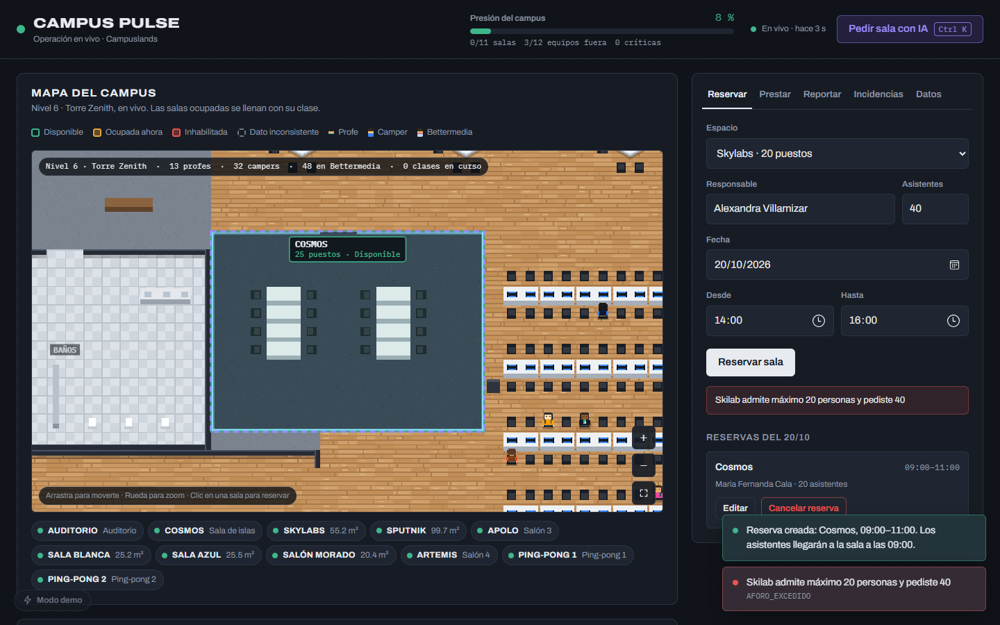
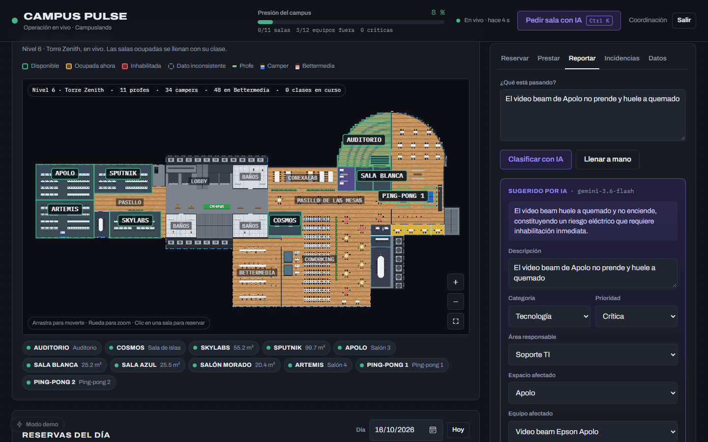
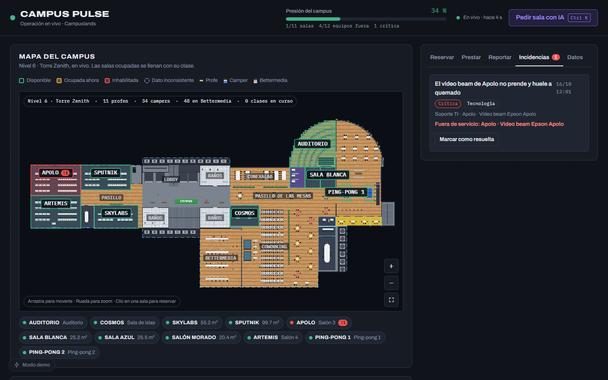
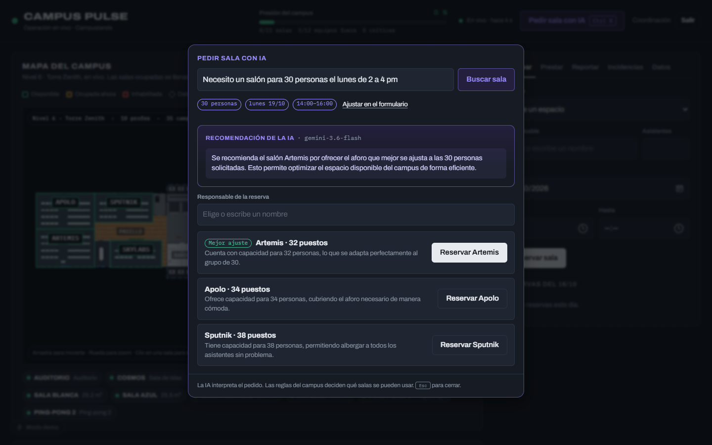
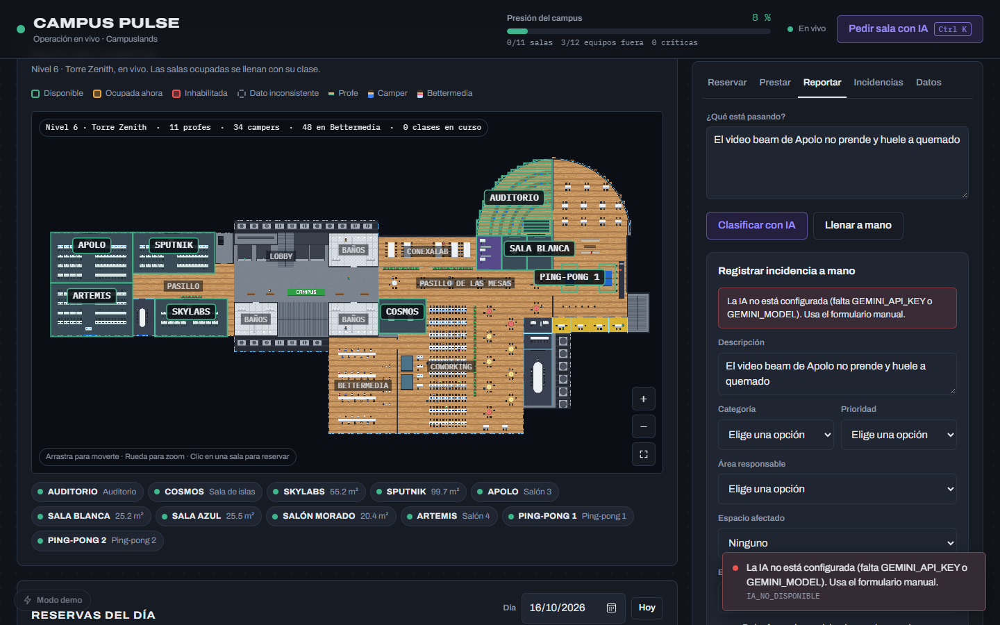

# Guion de la demo

Demostración de Campus Pulse en 3 minutos. Cada paso muestra una regla de negocio o el papel de
la IA. Antes de empezar: iniciar sesión (o **Crear una cuenta** la primera vez) y pestaña
**Datos → Restaurar datos iniciales**.

## 1. Datos oficiales y su calidad

Pestaña **Datos**. Se ven los 9 espacios oficiales cargados desde `data/raw/espacios.csv` y el
reporte de calidad. Cualquier registro inválido (duplicado, vacío, aforo no numérico o ≤ 0)
aparece aquí con su fila y motivo, sin romper la aplicación.

## 2. Mapa de ocupación

Cada sala se dibuja proporcional a su aforo, con color por estado: verde disponible, ámbar
ocupada, rojo inhabilitada y gris dato inconsistente.

## 3. Reglas de reservas

| Acción | Resultado esperado |
|---|---|
| Reservar **Cosmos** para 20 personas | Se acepta |
| Reservar **Cosmos** en la misma franja | Se rechaza por solapamiento |
| Reservar **Skilab** para 40 personas | Se rechaza por aforo (máximo 20) |

## 4. Incidencia con IA

Reportar: _"El video beam de Apolo no prende y huele a quemado"_.

1. La IA sugiere categoría, prioridad, área, espacio y equipo, con su razón (**"Sugerido por IA"**).
2. La persona revisa, puede editar y confirma.
3. Por ser crítica, **Apolo se pone rojo** y su video beam queda en reparación.

## 5. Las reglas deciden

| Acción | Resultado esperado |
|---|---|
| Reservar **Apolo** | Se rechaza: está inhabilitado |
| Prestar un equipo **dañado** | Se rechaza: no puede pasar de dañado a prestado |

## 6. Asistente de reservas (Ctrl+K)

_"Necesito un salón para 30 personas mañana de 2 a 4 pm"_. La IA entiende la solicitud, las
reglas filtran las salas libres que cumplen todo y la IA solo explica las opciones.

## 7. Sin IA, el sistema sigue funcionando

Sin key de IA, el reporte muestra un error claro y abre el formulario manual. Nunca se inventa
una respuesta.

