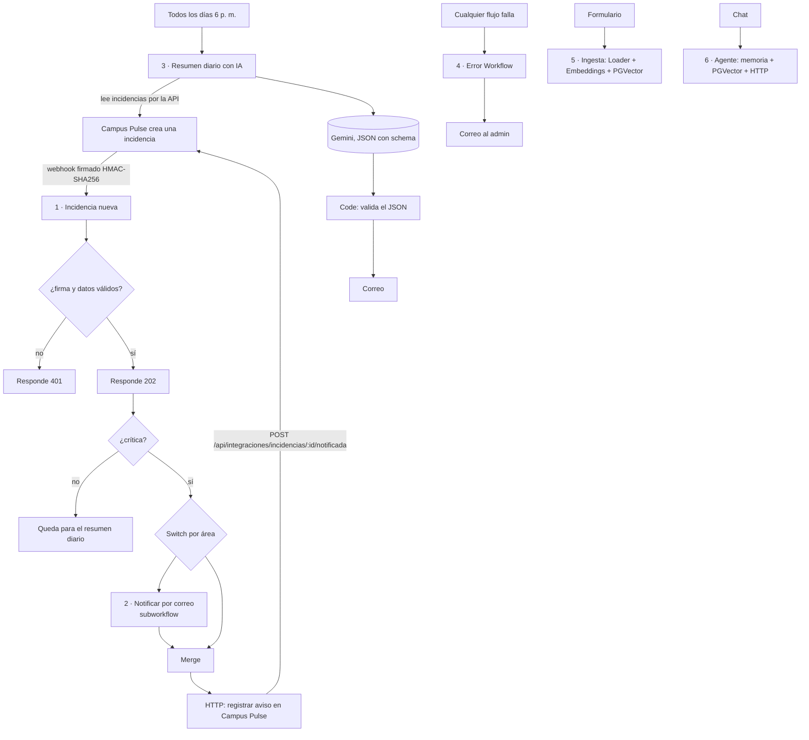

# Automatización con n8n y webhooks

Campus Pulse usa **n8n** (edición Community, autoalojada en Docker, sin tarjeta ni cuenta en la nube) para automatizar
lo que pasa *alrededor* de las incidencias: avisar al área responsable, resumir el día con IA, ingerir documentos y
ofrecer un agente de consulta para el personal de coordinación.

Los flujos están exportados como JSON en [`n8n/`](../n8n/) y se importan con un comando. Probado con **n8n 2.47.4**
(la versión está fijada en `compose.yaml`).

## Cómo ponerlo en marcha

1. En `.env` define un secreto largo y aleatorio (el mismo lo usan Campus Pulse y n8n):
   ```bash
   openssl rand -hex 24      # copia el resultado en .env como N8N_SECRETO=...
   ```
2. Levanta todo y carga los flujos:
   ```bash
   docker compose up -d --build
   npm run n8n:preparar      # crea las credenciales, importa y activa los 6 flujos, y reinicia n8n
   ```
3. Abre el editor en <http://localhost:5678> (la primera vez n8n pide crear una cuenta de dueño local) y el buzón de
   correos de prueba en <http://localhost:8025> (Mailpit: los correos **no salen a Internet**). El formulario de ingesta
   está en <http://localhost:5678/form/ingesta-conocimiento>.

Sin `N8N_SECRETO` la integración queda **apagada**: Express no envía el webhook y las rutas `/api/integraciones`
responden 503. Nunca quedan abiertas.

## Los flujos



| # | Flujo | Qué hace | Temas del curso que cubre |
|---|---|---|---|
| 1 | **Incidencia nueva** (`pulseIncidenciaNueva`) | Recibe el webhook, valida firma, antigüedad y datos, responde 202 y, si la incidencia es crítica, la enruta por área, avisa por correo y deja constancia en Campus Pulse | Webhook, Respond to Webhook, Code, **IF**, **Switch**, **Execute Workflow**, **Merge**, **HTTP Request**, reintentos |
| 2 | **Notificar por correo** (`pulseNotificar`), subworkflow | Envía el correo al destinatario y devuelve el resultado | Execute Workflow Trigger, Send Email |
| 3 | **Resumen diario con IA** (`pulseResumenDiario`) | Todos los días a las 6 p. m. (hora de Bogotá), o a mano, lee las incidencias abiertas de hoy, le pide a Gemini un resumen en JSON y **lo valida en un Code node** antes de enviarlo | Schedule Trigger, HTTP Request, IA dentro de un workflow con salida estructurada, validación |
| 4 | **Error Workflow** (`pulseErrores`) | Cuando cualquier flujo falla, avisa al admin con el flujo, el nodo, el mensaje y el ID de la ejecución | Error Trigger, manejo de errores |
| 5 | **Ingesta de documentos** (`pulseIngesta`) | Un formulario recibe un `.md` o `.txt`, lo parte, calcula sus embeddings con Gemini y los guarda en PostgreSQL (pgvector) | Form Trigger, Extract From File, **Document Loader**, **Text Splitter**, **Embeddings**, **PGVector Store** |
| 6 | **Agente de coordinación** (`pulseAgente`) | Un chat (<http://localhost:5678/webhook/4a2647d3-21f1-4ac0-8468-3eed27fdcfa9/chat>) con un **AI Agent** con **memoria** (PostgreSQL) y dos herramientas: `consultar_politicas` (PGVector, 4 resultados con metadata) y `listar_incidencias_abiertas` (HTTP) | Chat Trigger, AI Agent, memoria, vector store como herramienta, HTTP como herramienta |

### El webhook firmado (flujo 1)

Cuando se crea una incidencia, Express envía `POST /webhook/incidencia-nueva` con estas cabeceras:

- `x-pulse-timestamp`: segundos desde 1970.
- `x-pulse-firma`: `sha256=` + HMAC-SHA256 de `"<timestamp>.<cuerpo>"` con el secreto compartido.

n8n recalcula la firma sobre el **cuerpo crudo** (el nodo Webhook guarda el cuerpo exacto) y la compara en tiempo constante.
Rechaza con 401 si la firma no coincide, si el mensaje tiene más de 5 minutos (**replay**) o si los datos no tienen el
formato esperado. El código de Express (`src/integraciones/n8n.js`) y el del Code node de n8n deben seguir siendo
compatibles: `tests/n8n-flujos.test.js` ejecuta el código del Code node con firmas generadas por Express.

Del webhook **no salen** datos personales (ni quién reportó ni lo que sugirió la IA).

### La vuelta: n8n llama a Campus Pulse

n8n no es una persona con sesión: se autentica con el mismo secreto en la cabecera `x-pulse-token`
(`src/routes/integraciones.js`, montadas antes de exigir sesión):

- `GET /api/integraciones/incidencias?fecha=hoy&estado=abierta` (lo usan el resumen diario y el agente).
- `POST /api/integraciones/incidencias/:id/notificada` deja constancia en la tabla `incidencias_notificaciones`. Si n8n
  reintenta, el aviso no se duplica (`UNIQUE` en la base). La lista de incidencias de la app muestra *"Avisada: Soporte TI"*.

### Por qué las críticas avisan al instante y el resto va al resumen
Avisar de todo por correo satura a la gente y hace que ignoren lo importante. Las críticas (las que inhabilitan una sala o
un equipo) merecen una interrupción; el resto se agrupa en el resumen de las 6 p. m.

### El resumen diario: la IA redacta, el código verifica
Gemini recibe la lista del día y devuelve JSON con un *schema*. Antes de enviarlo, un Code node comprueba la forma, los
valores permitidos y **contrasta con los datos reales**: si la IA dice que hay 4 críticas y el código contó 1, el flujo falla
(y el Error Workflow avisa) en vez de mandar un resumen falso. Las cifras exactas las calcula el código, no la IA.

## Reintentos y errores

- Las llamadas HTTP y los envíos de correo reintentan 3 veces (2 s entre intentos; 5 s en la llamada a Gemini).
- Todos los flujos tienen como **Error Workflow** al flujo 4, que envía un correo al admin.
- **Lo que se vio al probarlo:** el Error Workflow *no estaba activo* y n8n lo dijo en el log ("is not active and cannot be
  executed"); sin eso, la red de seguridad no atrapaba nada. Por eso todos los flujos (incluido ese y el subworkflow) quedan
  activos, y un test lo exige.

## Qué se verificó, y cómo

Con n8n 2.47.4 real, Gemini real y la base de Campus Pulse (con una incidencia de prueba que se borró al terminar):

| Prueba | Resultado |
|---|---|
| Webhook firmado por Express, incidencia crítica de Soporte TI | Correo a `soporte-ti@campus.local`, aviso registrado en la base |
| Mismo flujo para Seguridad, Bienestar e Infraestructura | Cada área recibió su correo |
| Firma con otro secreto · cuerpo alterado · mensaje de hace 10 min · sin firma | Las 4 con **401** y su motivo |
| Incidencia **no** crítica | 202 y ningún correo |
| Callback sobre una incidencia que no existe (404) | 3 reintentos, y luego el Error Workflow envió el correo al admin |
| Resumen diario con Gemini | Correo con el resumen; la validación contrastó "1 crítica" con los datos reales |
| Formulario de ingesta con los 5 documentos | 16 fragmentos guardados en `n8n_conocimiento` |
| Agente: pregunta de política · seguimiento · incidencias abiertas · pregunta sin respuesta | Citó el archivo; entendió "¿y a qué hora terminan?" con la memoria; listó la incidencia; dijo que no sabía la clave del wifi |
| Reimportar los JSON exportados y repetir el webhook | Funciona: los archivos de `n8n/` son reproducibles |

Además, `tests/n8n-flujos.test.js` y `tests/integracion-n8n.test.js` cubren la estructura de los flujos, el código de los Code
nodes, la firma, la autenticación y el registro (sin necesitar n8n).

## Límites y decisiones que conviene conocer

- **Si n8n está caído, el aviso se pierde:** Express hace un solo intento (5 s) y no hay cola. La incidencia se crea igual y
  el resumen diario la incluye, pero la alerta inmediata no. Una cola o un reintento desde Campus Pulse sería la mejora.
- **Un solo canal real: correo.** Va a Mailpit, un buzón local. El plan mencionaba también Telegram; no se construyó porque
  exige crear un bot y no se podía verificar sin cuenta. Los destinatarios (`soporte-ti@campus.local`, etc.) son de ejemplo.
- **Dos bases vectoriales de conocimiento, con dimensiones distintas.** El nodo de embeddings de Gemini de n8n **no permite
  elegir las dimensiones** y devuelve 3072; pgvector no admite un índice HNSW de más de 2000. Por eso los flujos 5 y 6 usan la
  tabla `n8n_conocimiento` (3072, sin índice, búsqueda exacta, suficiente para pocos documentos) y el servicio `pulse-ai`
  usa `conocimiento` (768, con HNSW). Comprobado en la base: `vector_dims = 3072` frente a 768.
- **Los fragmentos de n8n son menos precisos.** El Text Splitter de n8n corta por tamaño (700 caracteres) y no por títulos:
  quedaron 16 fragmentos sin sección, frente a 33 con sección en `pulse-ai`. El agente cita el archivo, no la sección.
- **El modo *insert* del nodo PGVector agrega:** subir dos veces el mismo documento por el formulario duplicaría sus
  fragmentos (no se probó; es el comportamiento esperado del modo). `pulse-ai`, en cambio, reemplaza por archivo.
- **Seguridad de n8n:** para que los flujos lean `$env.N8N_SECRETO` y verifiquen la firma con `crypto`, `compose.yaml` activa
  `N8N_BLOCK_ENV_ACCESS_IN_NODE=false` y `NODE_FUNCTION_ALLOW_BUILTIN=crypto`. Cualquiera que pueda editar flujos en n8n
  podría leer variables de entorno: en un despliegue real, solo administradores deben tener acceso al editor.
- **Las claves viven en n8n.** `npm run n8n:preparar` crea credenciales con la key de Gemini y la clave de la base dentro
  del volumen `n8n_data` (cifradas por n8n). No están en `n8n/*.json` (solo referencias) ni en el repositorio.
- **El agente solo consulta lo que se ingirió por el formulario** (`n8n_conocimiento`), no `knowledge/` automáticamente.
- **No hay autenticación en el chat del agente** (es público en `localhost`); para uso real habría que protegerlo.

## Archivos

| Archivo | Qué es |
|---|---|
| `n8n/*.json` | Los 6 flujos exportados |
| `scripts/preparar-n8n.mjs` | Crea credenciales, importa y activa los flujos (`npm run n8n:preparar`) |
| `src/integraciones/n8n.js` | Firma y envío del webhook, comprobación del secreto |
| `src/routes/integraciones.js` | Rutas que llama n8n |
| `src/data/notificaciones.js`, `db/migrations/005_notificaciones.sql` | Registro de avisos |
